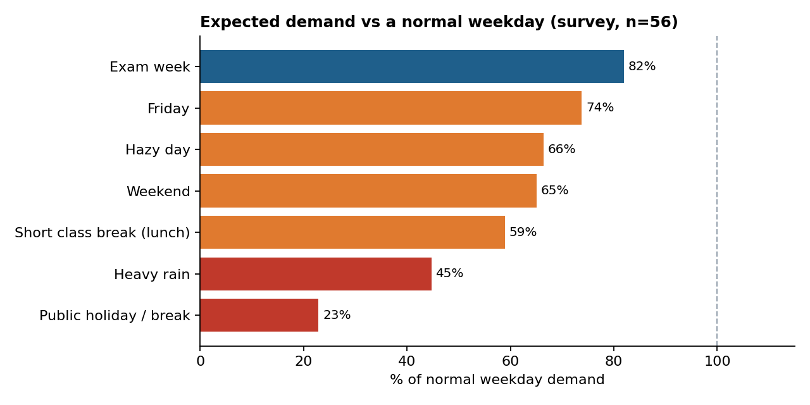
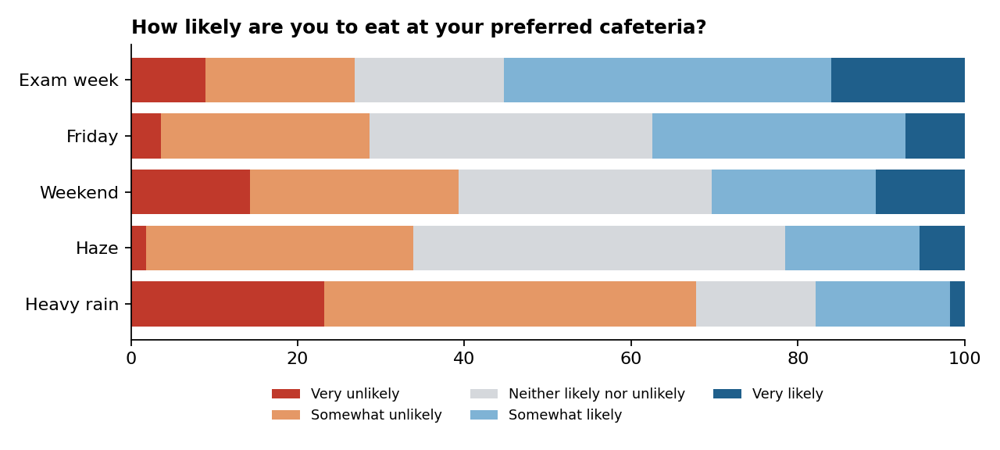

# 🍛 UTP Cafeteria Batch Advisor

**An AI batch-cooking advisor that helps UTP cafeteria vendors cut food waste and kitchen energy use.**

TEB2023 Artificial Intelligence · Group 13 · Universiti Teknologi PETRONAS · *AI Solutions for Sustainable Energy and Industry*
Supports **SDG 12** (Responsible Consumption & Production) and **SDG 7** (Affordable & Clean Energy).

> ⚠️ **Simulated prototype.** Predictions are estimates derived from a survey of 56 UTP students (Nov 2026), not from real sales records. The vendor always makes the final decision.

---

## The problem

Cafeteria vendors at UTP decide how much to cook from routine and guesswork. When fewer students turn up (heavy rain, exam weeks, public holidays), the surplus is thrown away at closing. The gas used to cook it is wasted too, and food warmers and exhaust hoods keep running through quiet afternoons.

## The solution

The vendor picks a **day**, **meal**, **academic calendar**, **weather** and whether classes have **short breaks**, then enters their **usual batch size**. The dashboard returns:

| Output | Example (Friday lunch, heavy rain, usual batch 120) |
|---|---|
| Surplus-waste risk tier + AI confidence | **High** risk · 100% confidence |
| Expected demand vs a normal weekday | 33% |
| Recommended portions (range) | **40** (36 – 44) |
| Cooking & energy plan | 24 portions first → small top-ups → switch off unused warmers after 2:30 PM |
| Estimated savings | 80 portions · 28 kg food · ≈ 35 kWh |
| Explanation | Survey factors applied + the decision-tree path |
| Week outlook | Risk tier for every day of the week |

The dashboard has three tabs: **Daily advisor**, **Survey insights** (all survey charts) and **AI model & method** (accuracy, confusion matrix, feature importance, test scenarios, assumptions, limitations).

## How it works

```
Student survey (n=56) ─► Demand multipliers ─► Simulated service history ─► Decision tree ─► Vendor advice
   16 questions            Likert → probability     252 scenarios × 20 days       Low/Med/High       batch, plan, energy
```

1. **Survey → multipliers** (`src/analyze_survey.py`). Likert answers are scored 0 / 0.25 / 0.5 / 0.75 / 1. Each condition is compared with a normal-weekday baseline: days per week at the cafeteria (capped at 5) ÷ 5 = 0.72.

   | Condition | Multiplier |
   |---|---|
   | Exam week | ×0.82 |
   | Friday | ×0.74 |
   | Hazy day | ×0.66 |
   | Weekend | ×0.65 |
   | Short class breaks (lunch) | ×0.59 |
   | **Heavy rain** | **×0.45** |
   | **Public holiday / break** | **×0.23** |

2. **Simulated dataset** (`src/build_dataset.py`). All 252 combinations of day type, calendar, weather, short breaks and meal are run for 20 simulated days each, with ±5% day-to-day noise. That gives 5,040 rows. Each day is labelled Low (≥ 80% of normal demand), Medium (55–80%) or High (< 55%) surplus-waste risk.
3. **Decision tree** (`src/train_model.py`). A scikit-learn `DecisionTreeClassifier` (depth 8) is trained on 75% of the rows and tested on the other 25%. The tree is exported to JSON, and the dashboard walks the same tree in the browser. The browser therefore gives exactly the same prediction as Python, and it can show the decision path.

### Results

- **Test accuracy:** 93.8% on held-out simulated days.
- **Agreement with the survey rule:** 100% across all 252 scenarios.
- **Most important factors:** heavy rain, public holiday, exam week.

| Test scenario | Demand | AI risk | Confidence |
|---|---|---|---|
| Normal Monday | 100% | Low | 100% |
| Normal Friday | 74% | Medium | 100% |
| Rainy Tuesday | 45% | High | 100% |
| Exam-week Wednesday | 82% | Low | 58% |
| Public holiday | 23% | High | 100% |
| Rainy Friday | 33% | High | 100% |
| Hazy exam-week Monday (dinner) | 54% | High | 53% |
| Tuesday with short class breaks | 59% | Medium | 82% |

The low-confidence cases sit close to a tier boundary. The dashboard shows that uncertainty to the vendor instead of hiding it.

<p align="center">
  
  
</p>

## Run it

**Just view the dashboard.** Open `docs/index.html` in a browser. It needs internet access for the Chart.js charts and the web font.

**Rebuild the data and model:**

```bash
pip install -r requirements.txt
```

```bash
python src/run_all.py
```

This regenerates `data/survey_responses.csv`, `data/scenario_dataset.csv`, everything in `outputs/`, and `docs/data/dashboard_data.js`. To change an assumption (thresholds, demand floor, noise, tree depth), edit `src/config.py` and re-run.

## Project structure

```
data/
  raw/survey_export.csv         Microsoft Forms export (anonymous)
  survey_responses.csv          cleaned survey
  scenario_dataset.csv          simulated training data (5,040 rows)
src/
  config.py                     paths, scoring rules, thresholds, model settings
  analyze_survey.py             step 1: survey -> multipliers + report charts
  build_dataset.py              step 2: multipliers -> simulated labelled dataset
  train_model.py                step 3: decision tree, evaluation, dashboard export
  run_all.py                    runs all three steps
outputs/
  figures/                      PNG charts for the report (01-08)
  survey_summary.json           all survey counts, percentages and multipliers
  model_metrics.json            accuracy, confusion matrix, feature importance
  decision_tree_rules.txt       full tree as readable if/else rules
  test_scenarios.csv            test scenario results
docs/                           the dashboard (static HTML/CSS/JS)
  index.html, css/, js/app.js, data/dashboard_data.js
```

## Limitations

- **Small, skewed sample.** 56 students, mostly Year 2 and Village 5 residents. All cafeterias use the pooled data.
- **Stated, not observed, behaviour.** Students reported what they *would* do.
- **No sales or leftover records.** The training labels are simulated from survey weights, so the tree learns survey-derived rules.
- **Independence assumption.** Combined conditions are multiplied together. Demand is floored at 20%.
- **Illustrative energy and cost figures.** Food per portion, cooking kWh, warmer power and the grid CO₂ factor are assumptions. They can be edited on the *AI model & method* tab.
- **Cannot foresee sudden events,** such as campus programmes or outages.

**Next step:** log real cooked, sold and leftover numbers with one or two vendors for 2–4 weeks, then retrain on that data.

## Ethics

- The survey was anonymous and voluntary, and no names or identifiable data were collected.
- Every output is labelled as an estimate, and the vendor makes the final decision.

## Team: Group 13

Aqil bin Abdul Samad · Ahmad Ammir Harees bin Ahmad Azimi · Dzikra Ahmad Rizaldi Nurfadillah · Aimar Zufayri bin Zulfadli

Lecturer: Dr. Farahida Hanim binti Mausor

### References

- Achariam, N. (2026, June). *Malaysians throw away 6,000 tonnes of edible food daily.* New Straits Times.
- Ali, N. E. H., et al. (2022). Assessment of food waste and its causes in Universiti Teknologi Mara Perak Branch, Seri Iskandar Campus, Malaysia. *IJARBSS, 12*(8).
- Daud, R. M., Rahman, H. A., & Naim, F. (2022). Improving food security through quantification of food waste: A small study at university's cafeterias. *IJARBSS, 12*(14), 157–176.
